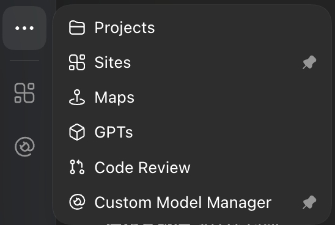
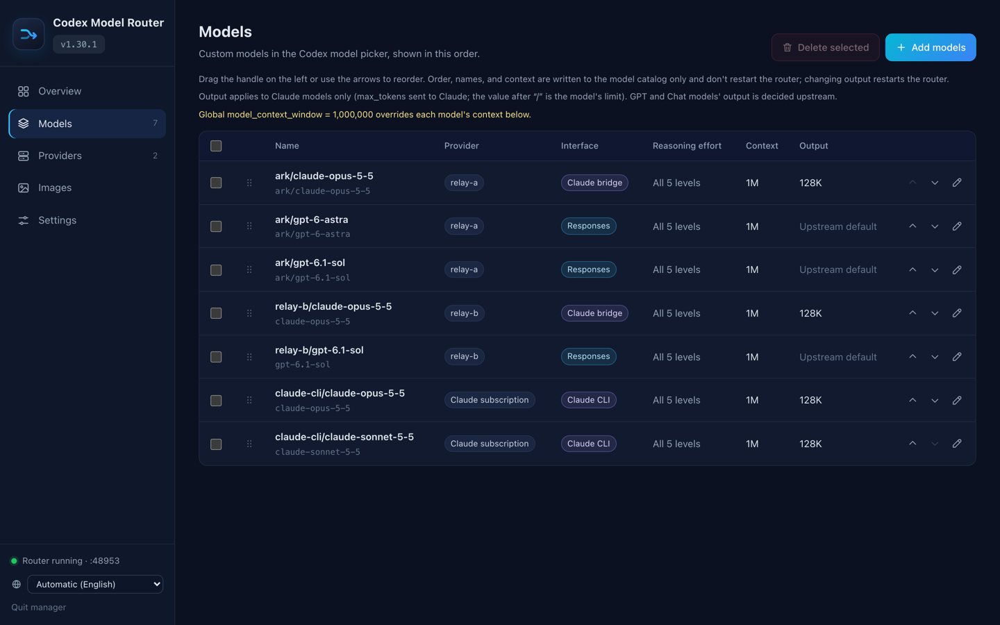
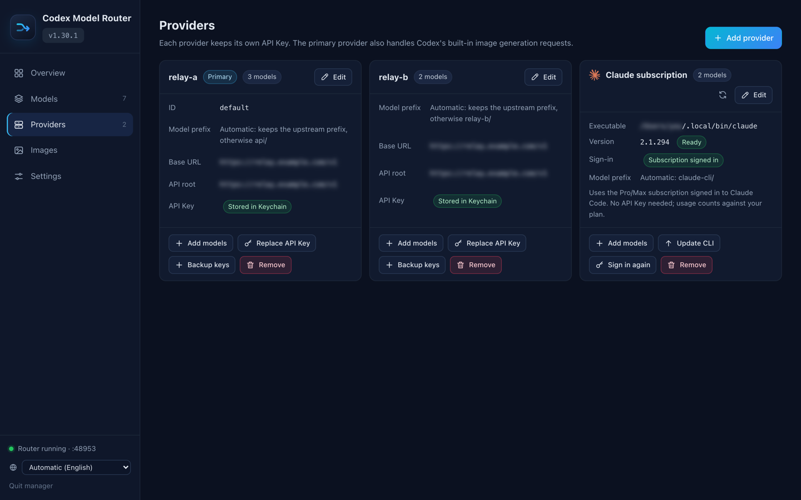

# codex-model-router — Multi-model routing for Codex Desktop

[简体中文](README.md) · [繁體中文](README.zh-TW.md) · [English](README.en.md)

**Add Claude and third-party API models to the Codex Desktop model picker, alongside the official GPT models.** Works on macOS and Windows.

It is a small router that runs on your computer (a local LLM proxy). Official models still go straight to OpenAI; only the custom models you add are sent to the API you configure. Your Codex sign-in, existing chats, and official models are unaffected.

- **Supported APIs**: OpenAI Responses API, Anthropic Claude Messages API, and Chat Completions-only endpoints (DeepSeek, Qwen, GLM, Kimi, Gemini, Ollama, vLLM, and more; capabilities are probed during setup).
- **Multiple providers**: connect several at once; each API key is stored encrypted (macOS Keychain / Windows DPAPI).
- **Standalone installation**: Codex is optional. You can use Claude Desktop alone; Node.js 22.15+ is required.
- **Web manager**: add or remove models, manage providers and API keys, and update in one click from your browser.
- **Optional**: relay image generation and Claude Code subscription routing.
- **Claude Desktop integration**: use “Claude → Claude Desktop” to connect your Claude API models or restore the previous configuration in one click. Settings are backed up; chats and unrelated preferences are preserved. GPT and CLI subscription routes are not supported in Claude Desktop yet. [Setup and limitations](docs/claude-desktop.md)

## Install

Before you start, you need:

- The client you want to use: Claude Desktop or Codex Desktop (ChatGPT Desktop). Neither is required to install just the manager
- Your provider's Base URL and API key when connecting API models; these are optional for manager-only installation
- macOS, or Windows 10 1809+ / Windows 11, and Node.js 22.15+. [Node.js LTS](https://nodejs.org/) is recommended; a compatible runtime bundled with Codex can also be used

**macOS**: run in Terminal

```bash
curl -fsSL --connect-timeout 10 --max-time 120 https://gh-proxy.com/https://github.com/funkeyyou/codex-model-router/raw/refs/heads/main/codex-model-router.sh -o codex-model-router.sh && bash codex-model-router.sh
```

**Windows**: run in PowerShell

```powershell
curl.exe -fsSL --connect-timeout 10 --max-time 120 https://gh-proxy.com/https://github.com/funkeyyou/codex-model-router/raw/refs/heads/main/codex-model-router.ps1 -o codex-model-router.ps1; if ($LASTEXITCODE -eq 0) { powershell -ExecutionPolicy Bypass -File .\codex-model-router.ps1 }
```

Use the accelerated commands above first. If the proxy is unavailable, use the direct GitHub commands below instead. Choose one method; do not run both.

<details>
<summary>Direct GitHub download (if the proxy is unavailable)</summary>

macOS:

```bash
curl -fsSL --connect-timeout 10 --max-time 120 https://github.com/funkeyyou/codex-model-router/raw/refs/heads/main/codex-model-router.sh -o codex-model-router.sh && bash codex-model-router.sh
```

Windows (PowerShell):

```powershell
curl.exe -fsSL --connect-timeout 10 --max-time 120 https://github.com/funkeyyou/codex-model-router/raw/refs/heads/main/codex-model-router.ps1 -o codex-model-router.ps1; if ($LASTEXITCODE -eq 0) { powershell -ExecutionPolicy Bypass -File .\codex-model-router.ps1 }
```

</details>

<details>
<summary>Download sources and verification</summary>

The recommended installation commands use the third-party service `gh-proxy.com`; separate direct GitHub commands are also available. Installer version checks and web manager updates try the proxy first, then automatically fall back to GitHub on failure. Only public files from this project use the proxy; model requests and API keys do not. Updates retain SHA-256, installer format and version checks. Files and checksums pass through the same proxy, so these checks are not independent release signature verification.

</details>

It first installs the web manager and a shortcut, then opens your browser. A Codex entry is added only when Codex is detected; installing Codex is optional. Click **Connect an API provider**, pick a common provider or enter a Base URL and API key, and choose the models to add to finish installing. Selected models are tested with real API requests, which may incur small charges. For Claude-only use, add Claude API models and connect under **Claude → Claude Desktop**. Global context and other Codex settings require Codex. If you install Codex later, connect it explicitly under **Codex settings**. If it's already installed, the manager opens directly. To use the terminal menu instead, add `menu` to the command (terminal prompts are currently in Traditional Chinese).

For a pinned version, download the installers and `SHA256SUMS` from [Releases](https://github.com/funkeyyou/codex-model-router/releases).

Restart Codex afterwards and the new models appear in the model picker:


*An actual model picker example. Prefixes and available models depend on your providers and account; these models are not bundled with the installer.*

## Usage

Most tasks can be done in the web manager. Open it from any of:

- the "Custom Model Manager" entry in Codex (named in the Codex display language), which appears after restarting Codex once
- the "模型路由器" shortcut (Start menu on Windows, `~/Applications` on macOS)
- the `ui` command







*Provider names and URLs in the screenshots are replaced or blurred.*

You can also run commands from the folder containing the installer: `bash codex-model-router.sh <command>` on macOS, or `powershell -ExecutionPolicy Bypass -File .\codex-model-router.ps1 <command>` on Windows. Without a command it opens the web manager; `menu` shows the terminal menu.

| Command | What it does |
| --- | --- |
| `ui` | Open the web manager |
| `menu` | Terminal menu (fallback for the web manager) |
| `update` | Upgrade, keeping all settings |
| `add`, `remove` | Add or remove custom models |
| `providers` | Add or remove providers, change API keys |
| `imagegen` | Configure relay image generation |
| `repair-models` | Fix stale or removed models in the picker |
| `status` | Check installation and service status |
| `diagnostics` | Export a diagnostics bundle to the desktop (keys masked) to attach to bug reports |
| `rollback` | Remove the router |

## Update and uninstall

**Update**: use the version menu at the top left of the web manager, or run the `update` command. Your Base URL, API keys, and models are kept; a failed update is rolled back automatically.

**Uninstall**: run `rollback`. Chats that used Claude models may stop working with official models afterwards, so start a new chat for them ([details in Chinese](docs/troubleshooting.zh-TW.md#回退之後用過-claude-模型的舊對話會壞掉)).

## Limits

- Provider API usage is billed by your provider. This tool doesn't supply credits or unlock features your account lacks.
- Claude and Chat Completions models can use terminal, file editing, MCP, and other function tools (Chat Completions needs upstream tool-call support), but not OpenAI-hosted tools such as native web search or image generation. Use the relay image skill for images.
- Unofficial community project, not affiliated with OpenAI or Anthropic.

## More docs

- [More details in English](docs/guide.en.md): web manager, providers, updates, Claude subscription routing
- Complete reference in Chinese: [简体中文](docs/guide.md) · [繁體中文](docs/guide.zh-TW.md)
- Troubleshooting and health checks in Chinese: [简体中文](docs/troubleshooting.md) · [繁體中文](docs/troubleshooting.zh-TW.md)
- [Releases and changelogs](https://github.com/funkeyyou/codex-model-router/releases)

When [reporting an issue](https://github.com/funkeyyou/codex-model-router/issues), include your OS, desktop/CLI version, router version, and redacted error output. Do not include API keys or login tokens.

## License

MIT
