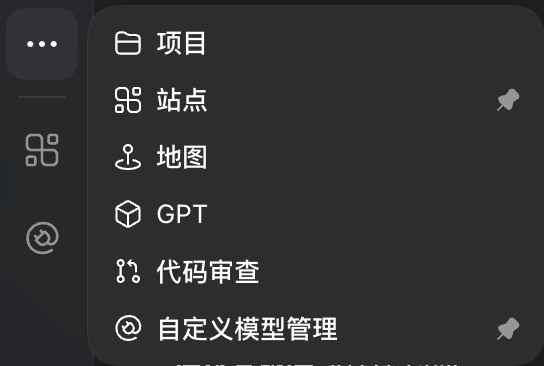
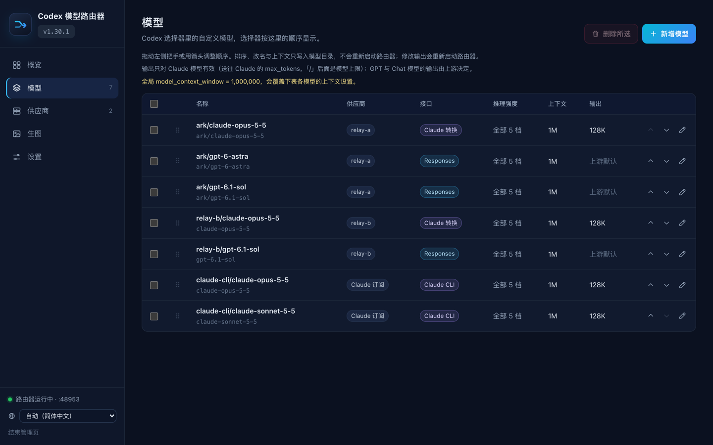

# codex-model-router — Codex 多模型路由工具

[简体中文](README.md) · [繁體中文](README.zh-TW.md) · [English](README.en.md)

**在 Codex Desktop 的模型菜单里加入 Claude 和第三方 API 模型，官方 GPT 照常使用。** 支持 macOS 与 Windows。

它是一个运行在你电脑上的小型路由器（本机 LLM proxy）：选官方模型时，请求照常发往 OpenAI；选你添加的自定义模型时，才发往你设置的 API。Codex 的登录、已有对话和官方模型都不受影响。

- **支持的 API**：OpenAI Responses API、Anthropic Claude Messages API，以及只有 Chat Completions 的兼容端点（DeepSeek、Qwen、GLM、Kimi、Gemini、Ollama、vLLM 等，安装时会实际探测能力）。
- **多家供应商**：可同时接入多家，API Key 各自加密保存（macOS 钥匙串／Windows DPAPI）。
- **网页管理页**：在浏览器里增删模型、管理供应商和 API Key、一键更新。
- **可选功能**：中转 API 生图、Claude Code 订阅路由。
- **Claude Desktop 接入**：在「Claude → Claude 客户端」一键配置第三方 Claude API 模型，也可一键回退。设置自动备份，聊天和其他偏好保留；暂不支持在 Claude 客户端使用 GPT 或 CLI 订阅路由。[使用说明](docs/claude-desktop.md)

## 安装

开始前请准备：

- 已用 ChatGPT 账号登录的 Codex Desktop（ChatGPT Desktop）
- 供应商的 Base URL 和 API Key
- macOS，或 Windows 10 1809 以上／Windows 11（需要 Node.js 22.15 以上，桌面版自带的即可，通常不用另外安装）

**macOS**：在「终端」中运行

```bash
(curl -fsSL --connect-timeout 10 --max-time 120 https://gh-proxy.com/https://github.com/funkeyyou/codex-model-router/raw/refs/heads/main/codex-model-router.sh -o codex-model-router.sh || curl -fsSL --connect-timeout 10 --max-time 120 https://github.com/funkeyyou/codex-model-router/raw/refs/heads/main/codex-model-router.sh -o codex-model-router.sh) && bash codex-model-router.sh
```

**Windows**：在 PowerShell 中运行

```powershell
curl.exe -fsSL --connect-timeout 10 --max-time 120 https://gh-proxy.com/https://github.com/funkeyyou/codex-model-router/raw/refs/heads/main/codex-model-router.ps1 -o codex-model-router.ps1
if ($LASTEXITCODE -ne 0) { curl.exe -fsSL --connect-timeout 10 --max-time 120 https://github.com/funkeyyou/codex-model-router/raw/refs/heads/main/codex-model-router.ps1 -o codex-model-router.ps1 }
if ($LASTEXITCODE -eq 0) { powershell -ExecutionPolicy Bypass -File .\codex-model-router.ps1 }
```

<details>
<summary>下载来源与校验说明</summary>

安装、版本检查和管理页下载更新优先使用第三方加速服务 `gh-proxy.com`，失败后自动改为直连 GitHub。仅代理本项目的公开文件，不转发模型请求或 API Key；更新仍检查 SHA-256、安装器格式与版本。代理提供的文件及校验清单经过同一服务，校验不代表独立的发布签名验证。

</details>

运行后会先安装网页管理页（含快捷方式与 Codex 里的入口，不改动任何模型设置），并在浏览器打开。在管理页点「连接 API 供应商」，选择常用供应商或填入 Base URL、API Key，勾选要添加的模型即可完成安装；选中的模型会先发送测试请求确认可用，可能产生少量费用。不急着添加模型的话，也可以先只在「设置」调整全局上下文。已经安装过的话会直接打开管理页。习惯终端操作可以在命令后加上 `menu` 使用终端菜单（提示目前为繁体中文）。

想固定版本或先校验文件哈希，见[固定版本并验证下载](docs/guide.md#固定版本并验证下载可选)。

完成后重新打开 Codex，就能在模型菜单里选到新模型：


*实际模型菜单示例。前缀与模型可用性取决于你的供应商及账号；截图不是预装模型清单。*

## 使用

大部分操作都能在网页管理页完成，任选一种方式打开：

- Codex 里的「自定义模型管理」入口（名称跟随 Codex 界面语言；安装后需重启 Codex 一次才会出现）
- 「模型路由器」快捷方式（Windows 在开始菜单，macOS 在 `~/Applications`）
- 运行 `ui` 命令






*截图中的供应商名称与网址已替换或模糊处理。*

也可以直接用命令（在安装器所在的文件夹运行）：macOS 用 `bash codex-model-router.sh <命令>`，Windows 用 `powershell -ExecutionPolicy Bypass -File .\codex-model-router.ps1 <命令>`。不带命令会打开网页管理页，`menu` 显示终端菜单。

| 命令 | 用途 |
| --- | --- |
| `ui` | 打开网页管理页 |
| `menu` | 终端菜单（网页管理页的备用方式） |
| `update` | 升级到新版，保留所有设置 |
| `add`、`remove` | 添加、删除自定义模型 |
| `providers` | 新增或移除供应商、更换 API Key |
| `imagegen` | 设置中转 API 生图 |
| `repair-models` | 模型菜单出现旧名称或已删除的模型时修复 |
| `status` | 查看安装与服务状态 |
| `diagnostics` | 导出诊断包到桌面（自动遮蔽 Key），反馈问题时附上 |
| `rollback` | 移除路由器 |

其他命令见[完整说明](docs/guide.md#其他指令)。

## 升级与移除

**升级**：在网页管理页左上角的版本菜单一键更新；或运行 `update` 命令。Base URL、API Key 和已添加的模型都会保留，不用重新设置；更新失败会自动还原。

**移除**：运行 `rollback`。用过 Claude 模型的旧对话，移除后切回官方模型可能无法继续，请新开对话（[原因](docs/troubleshooting.md#回退之后用过-claude-模型的旧对话会坏掉)）。

## 注意事项

- 第三方 API 的费用由供应商计算；本工具不提供模型额度，也不解锁账号未开放的功能。
- Claude 与 Chat Completions 模型可以使用终端、文件编辑、MCP 等常规工具（Chat Completions 需上游支持工具调用），但不能使用 OpenAI 平台内置的联网搜索、内置生图等工具；生图可改用中转 API 生图。详见[工具兼容性](docs/guide.md#工具可用性与兼容范围)。
- 非官方社区项目，与 OpenAI、Anthropic 无隶属关系。

## 更多文档

- [完整说明](docs/guide.md)：网页管理页、升级细节、多家供应商、Chat Completions 模型、中转生图、兼容性与运行细节
- [疑难排解与健康检查](docs/troubleshooting.md)
- [Claude Code 订阅路由](docs/claude-cli-experimental.md)（繁体中文）
- [Keysmith 全局开关](docs/keysmith.md)（繁体中文）：原版全局指令加载；使用 Claude 等其他模型前请先关闭
- [会话清理](docs/session-cleaner.md)（繁体中文）：批量改写历史拒绝回复、移除推理记录、同步桌面投影并备份还原
- [开发与发布](docs/development.md)
- [版本更新内容](https://github.com/funkeyyou/codex-model-router/releases)

反馈问题请到 [Issues](https://github.com/funkeyyou/codex-model-router/issues)，附上操作系统、桌面版版本、路由器版本和错误信息；请勿贴出 API Key 或登录令牌。

## 授权

MIT
