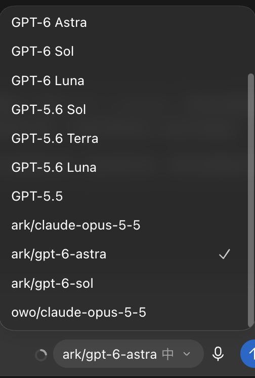
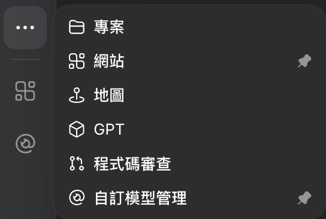
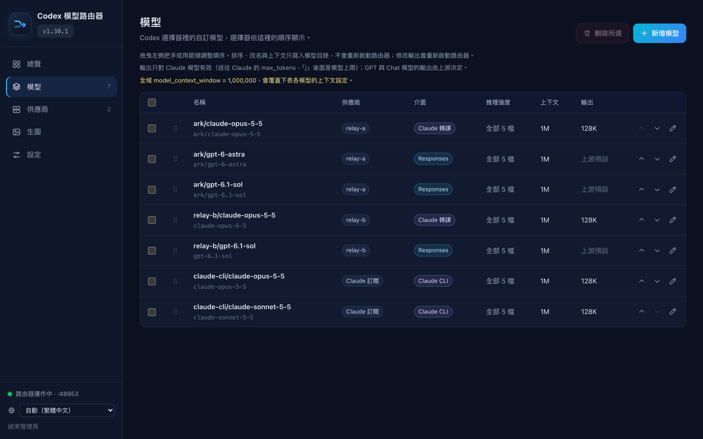
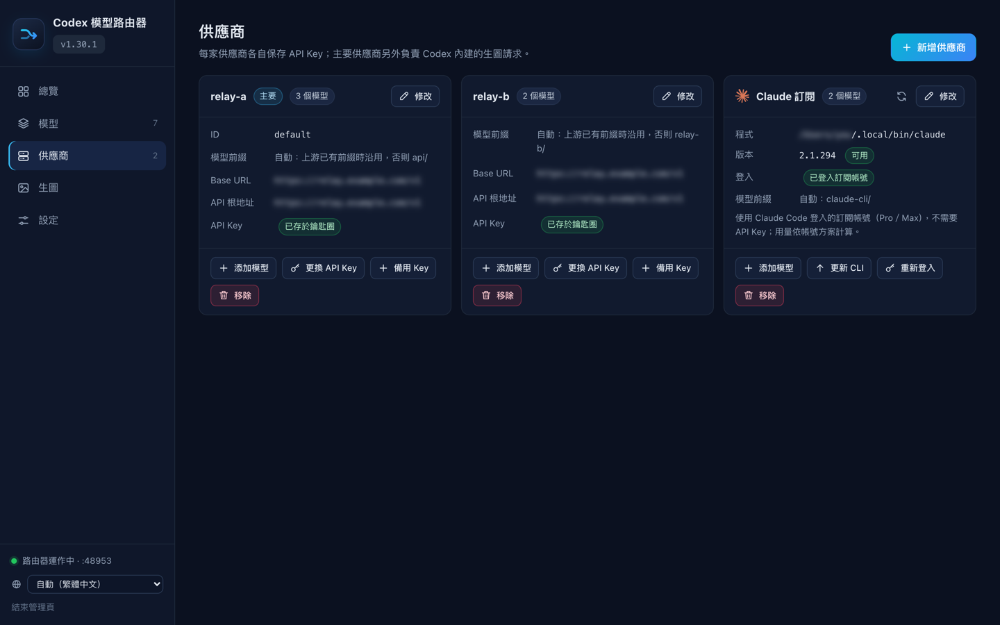

# codex-model-router — Codex 多模型路由工具

[简体中文](README.md) · [繁體中文](README.zh-TW.md) · [English](README.en.md)

**在 Codex Desktop 的模型選單裡加入 Claude 與第三方 API 模型，官方 GPT 照常使用。** 支援 macOS 與 Windows。

它是一個在你電腦上執行的小型路由器（本機 LLM proxy）：選官方模型時，請求照常送往 OpenAI；選你加入的自訂模型時，才送到你設定的 API。Codex 的登入、既有對話與官方模型都不受影響。

- **支援的 API**：OpenAI Responses API、Anthropic Claude Messages API，以及只有 Chat Completions 的相容端點（DeepSeek、Qwen、GLM、Kimi、Gemini、Ollama、vLLM 等，安裝時會實際探測能力）。
- **多家供應商**：可同時接多家，API Key 各自加密保存（macOS 鑰匙圈／Windows DPAPI）。
- **網頁管理頁**：在瀏覽器加減模型、管理供應商與 API Key、一鍵更新。
- **可選功能**：中轉 API 生圖、Claude Code 訂閱路由。
- **Claude Desktop 接入**：在「Claude → Claude 客戶端」一鍵設定第三方 Claude API 模型，也可一鍵回退。設定自動備份，聊天與其他偏好保留；暫不支援在 Claude 客戶端使用 GPT 或 CLI 訂閱路由。[使用說明](docs/claude-desktop.md)

## 安裝

開始前請準備：

- 已用 ChatGPT 帳號登入的 Codex Desktop（ChatGPT Desktop）
- 供應商的 Base URL 與 API Key
- macOS，或 Windows 10 1809 以上／Windows 11（需要 Node.js 22.15 以上，桌面版內建的即可，通常不必另外安裝）

**macOS**：在「終端機」執行

```bash
curl -fsSL --connect-timeout 10 --max-time 120 https://gh-proxy.com/https://github.com/funkeyyou/codex-model-router/raw/refs/heads/main/codex-model-router.sh -o codex-model-router.sh && bash codex-model-router.sh
```

**Windows**：在 PowerShell 執行

```powershell
curl.exe -fsSL --connect-timeout 10 --max-time 120 https://gh-proxy.com/https://github.com/funkeyyou/codex-model-router/raw/refs/heads/main/codex-model-router.ps1 -o codex-model-router.ps1; if ($LASTEXITCODE -eq 0) { powershell -ExecutionPolicy Bypass -File .\codex-model-router.ps1 }
```

建議使用上方的加速指令；只有加速服務無法使用時，才改用下方的 GitHub 直連指令，兩者擇一即可。

<details>
<summary>GitHub 直連（加速無法使用時選用）</summary>

macOS：

```bash
curl -fsSL --connect-timeout 10 --max-time 120 https://github.com/funkeyyou/codex-model-router/raw/refs/heads/main/codex-model-router.sh -o codex-model-router.sh && bash codex-model-router.sh
```

Windows（PowerShell）：

```powershell
curl.exe -fsSL --connect-timeout 10 --max-time 120 https://github.com/funkeyyou/codex-model-router/raw/refs/heads/main/codex-model-router.ps1 -o codex-model-router.ps1; if ($LASTEXITCODE -eq 0) { powershell -ExecutionPolicy Bypass -File .\codex-model-router.ps1 }
```

</details>

<details>
<summary>下載來源與校驗說明</summary>

安裝指令優先推薦第三方加速服務 `gh-proxy.com`，同時提供獨立的 GitHub 直連指令。安裝器的版本檢查和管理頁更新會優先使用代理，失敗後自動直連 GitHub。僅代理本專案的公開檔案，不轉發模型請求或 API Key；更新仍檢查 SHA-256、安裝器格式與版本。代理提供的檔案及校驗清單經過同一服務，校驗不代表獨立的發布簽章驗證。

</details>

執行後會先安裝網頁管理頁（含捷徑與 Codex 裡的入口，不改動任何模型設定），並在瀏覽器開啟。在管理頁點「連接 API 供應商」，選擇常用供應商或填入 Base URL、API Key，勾選要加入的模型即可完成安裝；選中的模型會先發送測試請求確認可用，可能產生少量費用。不急著加模型的話，也可以先只在「設定」調整全域上下文。已經安裝過的話會直接開啟管理頁。習慣終端操作可以在指令後加上 `menu` 使用終端選單。

想固定版本或先核對檔案雜湊，見[固定版本並驗證下載](docs/guide.zh-TW.md#固定版本並驗證下載可選)。

完成後重新開啟 Codex，就能在模型選單選到新模型：



*實際模型選單示例。前綴與模型可用性取決於你的供應商及帳號；截圖不是預裝模型清單。*

## 使用

大部分操作都能在網頁管理頁完成，開啟方式任選一種：

- Codex 裡的「自訂模型管理」入口（名稱跟隨 Codex 介面語言；安裝後重開 Codex 一次才會出現）
- 「模型路由器」捷徑（Windows 在開始功能表，macOS 在 `~/Applications`）
- 執行 `ui` 指令







*截圖中的供應商名稱與網址已替換或模糊處理。*

也可以直接下指令（在安裝器所在的資料夾執行）：macOS 用 `bash codex-model-router.sh <指令>`，Windows 用 `powershell -ExecutionPolicy Bypass -File .\codex-model-router.ps1 <指令>`。不帶指令會開啟網頁管理頁，`menu` 顯示終端選單。

| 指令 | 用途 |
| --- | --- |
| `ui` | 開啟網頁管理頁 |
| `menu` | 終端選單（網頁管理頁的備用方式） |
| `update` | 升級到新版，保留所有設定 |
| `add`、`remove` | 加入、刪除自訂模型 |
| `providers` | 新增或移除供應商、更換 API Key |
| `imagegen` | 設定中轉 API 生圖 |
| `repair-models` | 模型選單出現舊名稱或已刪除的模型時修復 |
| `status` | 查看安裝與服務狀態 |
| `diagnostics` | 匯出診斷包到桌面（自動遮蔽 Key），回報問題時附上 |
| `rollback` | 移除路由器 |

其他指令見[完整說明](docs/guide.zh-TW.md#其他指令)。

## 升級與移除

**升級**：在網頁管理頁左上角的版本選單一鍵更新；或執行 `update` 指令。Base URL、API Key 與已加入的模型都會保留，不必重新設定；更新失敗會自動還原。

**移除**：執行 `rollback`。用過 Claude 模型的舊對話，移除後切回官方模型可能無法繼續，請改開新對話（[原因](docs/troubleshooting.zh-TW.md#回退之後用過-claude-模型的舊對話會壞掉)）。

## 注意事項

- 第三方 API 的費用由供應商計算；本工具不提供模型額度，也不解鎖帳號未開放的功能。
- Claude 與 Chat Completions 模型能用終端機、檔案編輯、MCP 等一般工具（Chat Completions 需上游支援工具呼叫），但不能用 OpenAI 平台內建的網頁搜尋、內建生圖等工具；生圖可改用中轉 API 生圖。詳見[工具相容性](docs/guide.zh-TW.md#工具可用性與相容範圍)。
- 非官方社群專案，與 OpenAI、Anthropic 無隸屬關係。

## 更多文件

- [完整說明](docs/guide.zh-TW.md)：網頁管理頁、升級細節、多家供應商、Chat Completions 模型、中轉生圖、相容性與運作細節
- [疑難排解與健康檢查](docs/troubleshooting.zh-TW.md)
- [Claude Code 訂閱路由](docs/claude-cli-experimental.md)
- [Keysmith 全域開關](docs/keysmith.md)：原版全域指令載入；使用 Claude 等其他模型前請先關閉
- [會話清理](docs/session-cleaner.md)：批次改寫歷史拒絕回覆、移除推理紀錄、同步桌面投影並備份還原
- [開發與發布](docs/development.zh-TW.md)
- [版本更新內容](https://github.com/funkeyyou/codex-model-router/releases)

回報問題請到 [Issues](https://github.com/funkeyyou/codex-model-router/issues)，附上作業系統、桌面版版本、路由器版本與錯誤訊息；請勿貼出 API Key 或登入權杖。

## 授權

MIT
